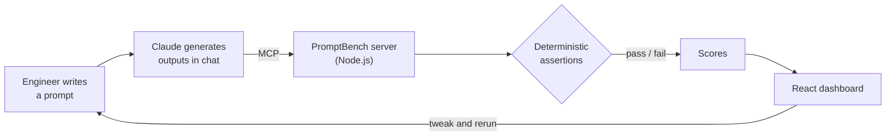

## Hi, I'm Rakeen 👋

I'm a full-stack engineer in Sydney. I build web products end to end, and increasingly the AI systems that sit inside them: retrieval, agents, evaluation, extraction.

I've spent 3+ years shipping software across healthcare, insurance, mobility and enterprise teams, usually arriving in a codebase I'd never seen and leaving it with something in production. That's taught me to read code before writing it, ask about the business before the schema, and keep things simple enough that the next person can own them.

---

### What I'm into

**🧠 Making LLMs dependable.** Getting a model to do something once is easy. Getting it to do it every time is engineering. I spend a lot of time on evaluation, deterministic checks, retrieval quality and agent orchestration.

**🧱 Full-stack product work.** TypeScript and React on the front, Python or Node on the back, a real database underneath, deployed somewhere it can be watched.

**🔍 Understanding things by rebuilding them.** When something feels like magic, I build a small version of it until it doesn't.

---

### Some of the things I've built

<table>
  <tr>
    <td width="50%" valign="top">
      
      
<b>PromptBench</b>

      
Benchmarks prompts against deterministic assertions so teams iterate on LLM behaviour with evidence, not vibes. Adopted by 30+ engineers; iteration went from ~2 hours to under 30 minutes.

      
<code>Node.js</code> <code>MCP</code> <code>React</code>

       
    </td>
    <td width="50%" valign="top">
      
      
<b>Docket</b>

      
Photograph a receipt, and Claude Vision reads it and classifies it against Australian tax deduction rules. Not on any store. I sideload it and use it every week.

      
<code>React Native</code> <code>Expo</code> <code>Claude Vision</code> <code>SQLite</code>

       
    </td>
  </tr>
  <tr>
    <td width="50%" valign="top">
      
      
<b>Lisp interpreter</b>

      
A Clojure-flavoured language with its own parser, evaluator and REPL, written in Scala and ported to TypeScript. <a href="https://rakeenabtahee.com">Try it live on my site.</a>

      
<code>Scala</code> <code>TypeScript</code>

       
    </td>
    <td width="50%" valign="top">
      
      
<b>Jellyfish aquarium</b>

      
Started in Canvas 2D, rebuilt in Three.js with GLSL shaders written from scratch. It has no purpose. It's the best-looking thing I've made.

      
<code>Three.js</code> <code>GLSL</code> <code>WebGL</code>

       
    </td>
  </tr>
  <tr>
    <td width="50%" valign="top">
      
      
<b>rakeenabtahee.com</b>

      
My portfolio, built from scratch: a live REPL, interactive WebGL shaders, a command palette and a force-directed graph written without d3.

      
<code>Next.js</code> <code>React</code> <code>Three.js</code>

       
    </td>
    <td width="50%" valign="top">
      
      
<b>Monte Carlo simulator</b>

      
Sentiment-adjusted Monte Carlo simulation for long-only equity portfolios, part of a personal quant research stack.

      
<code>Python</code> <code>DuckDB</code> <code>Parquet</code>

       
    </td>
  </tr>
</table>

---

### How PromptBench works

Most LLM eval tools need an API key and a bill. PromptBench doesn't call a model at all: the model you're already chatting with generates the outputs, and the server only scores them.

---

### In production

Work I've shipped inside client and company teams. The code is private, so here's what it did.

| | What it did | Built with |
| --- | --- | --- |
| **Compliance reviewer** | Multi-agent system that reviews documents against regulatory requirements | `LangGraph` `FastAPI` `Next.js` |
| **Expertise search** | RAG over a Confluence corpus that infers who has delivered work in a domain | `Python` `RAG` `Claude API` |
| **Claims OCR pipeline** | Structured extraction from health insurance claims; manual entry down 80%+ | `FastAPI` `Async Python` |
| **CRM migration** | 1.5M records moved off a legacy system with my team, no loss of service | `Python ETL` `FastAPI` `Next.js` |
| **Test case generator** | Turns Jira tickets into test cases automatically | `AWS Lambda` `LLMs` |

---

### Toolbox

| Area | Tools |
| --- | --- |
| **Languages** | `TypeScript` `Python` `Java` `Scala` `C#` `Dart` `SQL` |
| **Frontend** | `React` `Next.js` `Tailwind` `Three.js` `React Native` `Flutter` |
| **Backend** | `Node.js` `FastAPI` `PostgreSQL` `SQLite` `DuckDB` |
| **AI** | `Claude API` `MCP` `LangGraph` `RAG` `Vision models` `Evals` |
| **Cloud & delivery** | `AWS Lambda` `API Gateway` `S3` `GCP` `Docker` `GitHub Actions` |
| **Enterprise platforms** | `Salesforce (Apex, LWC)` `Power Platform` `Workato` `Zoho` |

---

### Elsewhere

🌐 [rakeenabtahee.com](https://rakeenabtahee.com) · 💼 [LinkedIn](https://www.linkedin.com/in/rakeena/) · ✉️ rakeenabtahee@gmail.com

I speak English, Bangla, Hindi, Urdu and German. Happy to talk about agents, evals, interpreters, or why your prompt works on Tuesdays but not Wednesdays.
